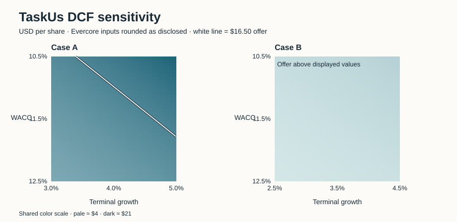

# M&A Valuation Reconstruction

Can an outside reader reproduce a merger adviser’s valuation from public filings? This study reconstructs both TaskUs forecast cases and audits eight eligible cash deals. Three supported a per-share reconstruction using public inputs. Five disclosures left material gaps.

| TaskUs forecast | Reconstructed range | Published range | Endpoint errors |
|---|---:|---:|---:|
| A | $12.25–$20.56 | $12.40–$20.20 | −$0.15 / +$0.36 |
| B | $4.99–$7.63 | $5.10–$7.50 | −$0.11 / +$0.13 |

The ranges use values rounded in the public exhibit. The Case A midpoint is **$15.30** versus $15.28 on the adviser slide. Holding the terminal cash-flow base fixed across growth rates leaves larger errors at the endpoints. Case B was supplied for reference in the adviser’s analysis. See the [results memo](RESULTS.md) for the working-capital sensitivity and [screening log](screening.csv) for the scope of the cross-deal work.



## Reproduce

Install Python 3.11 or newer. The study requires only the standard library.

```sh
git clone https://github.com/NeilMeher/ma-valuation-reconstruction.git
cd ma-valuation-reconstruction
python -m unittest -v
python study.py
```

The small [input table](inputs.csv) is the full TaskUs pilot fixture. Run the study to regenerate [results.json](results.json), the heatmap, and the [cross-deal calculations](cross_deal.json). The [source register](SOURCES.md) and [cross-deal table](CROSS_DEAL.md) give the filing and slide locators. Benchmark tables store the adviser checks separately from the model inputs.

## Do the midpoint by hand

1. On slide 18 of the [May 8 Evercore exhibit](https://www.sec.gov/Archives/edgar/data/1829864/000119312525153528/d947061dex99cix.htm), find 2025–29 Case A cash flows of $60m, $100m, $113m, $120m and $127m. Discount at 11.5% over 0.5, 1.5, 2.5, 3.5 and 4.5 years. Their present value is about $387.63m.
2. Calculate terminal value as 133 × 1.04 ÷ (0.115 − 0.04) = $1,844.27m. Discount at 11.5% for 4.5 years to get $1,130.02m.
3. Add the two present values, then add $192m of cash and subtract $256m of debt. Divide the $1,453.65m equity value by 95.0m fully diluted shares. Compare $15.30 with the slide’s $15.28.
4. For a manual audit, compare the 0.613 and 0.580 discount factors on slide 18. Use a calculator to infer each holding period and decide which convention belongs to the perpetuity and which belongs to the exit multiple. Record your reasoning and the price change from substituting year-end discounting.

## Scope and credit

The [pilot protocol](PROTOCOL.md), [expansion protocol](EXPANSION.md) and [experiment log](EXPERIMENT.md) describe the design and verification. The eight deals form a purposive sample. Neil Meher commissioned the work and set the research, verification, and publication requirements. Codex assembled the filing inputs, built the model and figures, and ran the documented checks. Neil’s independent filing review and timing judgment are pending.
